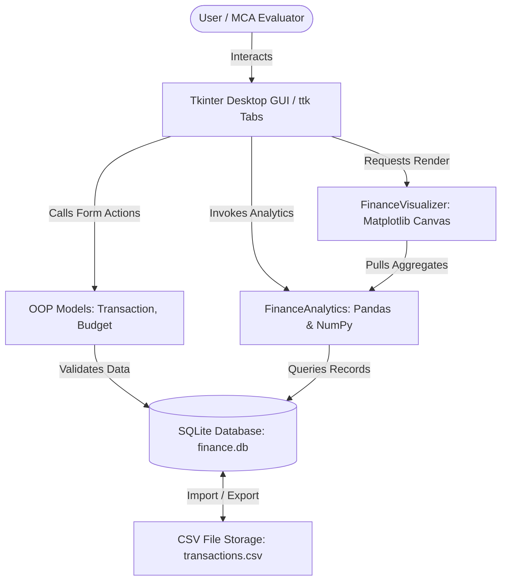

# ACADEMIC CASE STUDY & PROJECT REPORT

**Course:** Master of Computer Applications (MCA) – Data Science  
**Subject:** Python Programming Lab Mini-Project  
**Institution:** Chandigarh University, Gharuan, Mohali  
**Academic Year:** 2026–2027  
**Project Title:** Personal Finance and Expense Analytics System  

---

## 1. ABSTRACT
In modern financial management, personal budgeting and expense tracking are crucial for maintaining economic solvency and achieving long-term savings goals. Traditional manual recording methods, such as handwritten ledgers or unstructured spreadsheets, frequently suffer from human calculation errors, lack of validation, and an absence of automated visual analytical insights.

This mini-project presents the **Personal Finance and Expense Analytics System**, an end-to-end Python application engineered specifically for individual wealth tracking and budgeting. Developed with **Python 3.13**, the application leverages **Object-Oriented Programming (OOP)** for domain entities, a robust **SQLite** relational database for ACID-compliant persistence, **Pandas** and **NumPy** for high-performance aggregations and statistical computations, **Matplotlib** for spending pattern visualizations, and a **Tkinter (ttk)** desktop Graphical User Interface (alongside an optional **Streamlit** web architecture). The system enables users to record daily income and expenditure across standardized categories, formulate monthly budgets with over-spending threshold alerts, perform multi-parameter transaction filtering, analyze descriptive statistics (mean, median, standard deviation), and generate periodic daily, weekly, and monthly reports.

---

## 2. INTRODUCTION
Personal financial literacy is a critical determinant of financial well-being. With the proliferation of digital transactions via UPI, credit cards, and internet banking, individuals execute numerous micro-transactions daily. Without structured monitoring, discretionary expenditures frequently exceed budgeted limits.

Python has emerged as the premier programming language for data-centric software development due to its clean syntax, rich standard library, and versatile data processing ecosystem. This project bridges basic programming concepts (loops, functions, dictionaries, file handling) with applied data science tools (NumPy vectors, Pandas DataFrames, and Matplotlib data visualization). Designed as a modular 3-tier architecture, the system provides an intuitive graphical interface suitable for non-technical users while maintaining clean academic code standards for an MCA first-semester curriculum.

---

## 3. PROBLEM STATEMENT
Contemporary individuals face several challenges regarding personal expense management:
1. **Dispersed Transaction Records:** Inability to unify expenses incurred across cash, debit cards, credit cards, and UPI apps into a single ledger.
2. **Lack of Budgetary Accountability:** Absence of automated warning indicators when expenditures in specific categories (e.g., Dining, Entertainment) breach allocated limits.
3. **Absence of Visual Trends:** Raw numerical figures fail to impart immediate cognitive insight into spending habits, category concentration, or month-on-month savings trajectories.
4. **Data Vulnerability and Inflexibility:** Paper notes are easily lost, while commercial cloud applications frequently sell user transaction telemetry or require expensive subscriptions.

---

## 4. OBJECTIVES
The primary objectives of this software project are:
- To develop a standalone, secure, offline-capable Python application for recording daily income and expenses.
- To enforce strict input validation for monetary figures, dates, and categories using object-oriented encapsulation.
- To structure an SQLite database with parameterized SQL queries to eliminate SQL injection vulnerabilities.
- To formulate category-specific monthly budgets and provide variance monitoring (Under-budget, Warning >85%, and Over-budget alerts).
- To leverage **NumPy** for calculating descriptive expense distributions (Mean, Median, Standard Deviation, Quartiles).
- To utilize **Pandas** for pivot aggregations producing daily, weekly, and monthly reports.
- To embed dynamic **Matplotlib** visualizations (Donut Charts, Income vs. Expense Bar Charts, Spending Trajectories, and Variance Charts) directly into a native GUI.
- To provide bidirectional CSV data portability (Import/Export).

---

## 5. EXISTING SYSTEM AND ITS LIMITATIONS

| Feature / Aspect | Existing System (Manual Ledgers / Excel) | Proposed System (Personal Finance System) |
| :--- | :--- | :--- |
| **Data Entry** | Manual paper entry or arbitrary cell editing | Form-validated GUI input preventing invalid types |
| **Integrity & Storage**| Easily corrupted, no relational constraints | ACID-compliant SQLite relational database |
| **Budget Monitoring** | Manual reconciliation at month end | Real-time automated variance calculation & color alerts |
| **Statistical Analysis**| Requires manual formula writing | Automated NumPy statistical distribution engine |
| **Data Visualization** | Static manual chart drawing | Automated dynamic Matplotlib multi-panel plots |
| **Portability** | Non-standard format or physical binding | Standardized RFC 4180 CSV export and import |
| **Data Privacy** | Cloud apps store personal financial data remotely | 100% Local, offline storage on user machine |

---

## 6. PROPOSED SYSTEM
The proposed system is an integrated desktop analytical tool comprising four core layers:
1. **Presentation Layer (Tkinter GUI):** Provides clean tabbed navigation (`Executive Dashboard`, `Add Transaction`, `Transaction Ledger`, `Budget Planner`, `Visual Analytics`, `Periodic Reports`) with embedded canvas widgets.
2. **Business Logic & Analytics Layer (Pandas & NumPy):** Transforms raw database rows into structured dataframes, calculating metrics such as savings rate, budget utilization, and IQR percentiles.
3. **Visualization Layer (Matplotlib):** Produces publication-grade charts embedded into GUI canvas frames with pan/zoom navigation controls.
4. **Data Persistence Layer (SQLite & CSV):** Handles relational schema enforcement, indices, parameter substitution, and CSV file input/output.

---

## 7. SOFTWARE AND HARDWARE REQUIREMENTS

### 7.1 Software Requirements
- **Operating System:** Windows 10/11, Linux (Ubuntu/Debian), or macOS.
- **Language:** Python 3.10+ (Tested on Python 3.13.14).
- **Core Standard Libraries:** `sqlite3`, `tkinter`, `csv`, `datetime`, `os`, `sys`, `typing`.
- **Third-Party Data Science Libraries:**
  - `pandas` (>= 2.0.0): Tabular data analysis and pivot tables.
  - `numpy` (>= 1.24.0): Array manipulation and statistical functions.
  - `matplotlib` (>= 3.7.0): Graphical chart rendering.
  - `python-docx` (Optional): Automated academic report generator.
  - `streamlit` (Optional): Alternative browser-based interface.

### 7.2 Hardware Requirements
- **Processor:** Dual-Core x86-64 / ARM processor (1.8 GHz or faster).
- **RAM:** Minimum 2 GB (4 GB recommended).
- **Storage:** Minimum 100 MB free space for code, dependencies, and local database.
- **Display:** 1280x720 minimum screen resolution.

---

## 8. SYSTEM ARCHITECTURE

### Architectural Highlights:
- **Loose Coupling:** The `DatabaseManager` operates independently of whether Tkinter, Streamlit, or a CLI launcher is invoking it.
- **Data Encapsulation:** All transactions are modeled as validated `Transaction` objects before reaching persistence.
- **Embedded Visuals:** Utilizes `FigureCanvasTkAgg` to mount Matplotlib figures directly inside native Tkinter frames without creating blocking popups.

---

## 9. METHODOLOGY

The development followed the **Iterative Waterfall Model**:
1. **Requirements Gathering:** Identifying typical personal spending categories, budget parameters, and analytical requirements for university students and young professionals.
2. **Schema & OOP Design:** Drafting normalized relational schema for `transactions` and `budgets` with check constraints and index keys. Designing `Transaction` and `Budget` classes.
3. **Database Layer Implementation:** Implementing `DatabaseManager` using Python's `sqlite3` context managers (`with conn:`) to ensure transaction rollbacks on failure.
4. **Data Science & Analytics Integration:** Formulating aggregation algorithms via Pandas pivot tables and computing standard deviation, variance, and percentiles with NumPy.
5. **Chart Engine Development:** Creating reusable visualization methods returning `Figure` objects with curated modern color palettes.
6. **GUI Implementation:** Structuring Tkinter notebook tabs, styling widgets with `ttk`, and binding data refresh cycles to UI actions.
7. **Verification & Testing:** Unit testing CRUD methods, checking boundary conditions (e.g., negative budget, invalid date strings, division by zero during savings calculations).

---

## 10. PYTHON CONCEPTS DEMONSTRATED

This project serves as a comprehensive demonstration of the Chandigarh University MCA 1st Semester Python Programming curriculum:

| Concept Category | Specific Python Construct | Where It Is Used in the Project |
| :--- | :--- | :--- |
| **Object-Oriented Programming (OOP)** | Classes, Constructors (`__init__`), Encapsulation, Properties (`@property`, `@setter`), Class Methods (`@classmethod`), String Representations (`__repr__`) | `models.py` (`Transaction`, `Budget`), `database.py` (`DatabaseManager`), `analytics.py` (`FinanceAnalytics`), `visualizer.py` (`FinanceVisualizer`) |
| **Data Structures** | Lists, Dictionaries, Tuples, Sets | Dictionaries for database rows (`sqlite3.Row`), Tuples for parameterized SQL insertion queries, Lists for Treeview item collections |
| **Functions & Modularity** | Named arguments, Type hinting (`typing.Optional`, `List`, `Dict`), Default parameters, Lambda expressions | Used throughout all modules for clean contract definitions and event callbacks |
| **Control Flow** | `if-elif-else` conditionals, `for` loops, list comprehensions, ternary operators | Status tagging (Over Budget vs Warning), keyword filtering, data transformations |
| **Exception Handling** | `try-except-finally`, `raise ValueError`, catching database errors | Validating monetary inputs, parsing dates (`strptime`), handling file missing exceptions |
| **File Handling** | `open()`, `csv.DictWriter`, `csv.DictReader`, context managers (`with`) | Exporting transaction logs to CSV and importing external spreadsheets in `database.py` |
| **Database Connectivity** | `sqlite3`, DDL `CREATE TABLE`, DML `INSERT`, `UPDATE`, `DELETE`, `SELECT`, parameterized queries (`?`) | `database.py` managing relational persistence |
| **Applied Data Science** | Pandas DataFrames, Series, `pivot_table()`, `groupby()`, `dt` accessors, NumPy arrays, `np.where()`, `np.percentile()`, `np.std()` | `analytics.py` computing monthly summaries, savings rates, and expense distributions |
| **Data Visualization** | Matplotlib `subplots()`, Donut charts, grouped bar charts, line plots, styling parameters | `visualizer.py` generating interactive graphics |
| **GUI Programming** | `tkinter`, `ttk.Notebook`, `ttk.Treeview`, `ttk.Combobox`, `StringVar`, event bindings | `app_gui.py` desktop user interface |

---

## 11. IMPLEMENTATION & CODE EXPLANATION

### 11.1 Module 1: Domain Models (`models.py`)
Encapsulates transaction attributes with rigorous validation.
- `Transaction._validate_date()`: Ensures dates adhere strictly to `YYYY-MM-DD` using `datetime.strptime`.
- `Transaction._validate_amount()`: Ensures monetary values are strictly positive float numbers rounded to 2 decimal places.
- `Transaction.to_dict()` and `to_tuple()`: Provide clean interfaces for serialization and SQLite database insertion.

### 11.2 Module 2: Persistence Layer (`database.py`)
Handles all communications with the SQLite file `finance.db`.
- `_initialize_tables()`: Executes DDL statements with `CHECK` constraints (e.g., `amount > 0` and `allocated_amount >= 0`) and secondary indices on `date`, `category`, and `type`.
- `add_transaction()` & `update_transaction()`: Execute parameterized queries with placeholder `?` marks to guard against SQL injection.
- `search_and_filter()`: Dynamically concatenates SQL `WHERE` conditions depending on whether the user provided keywords, dates, or category selections.
- `export_to_csv()`: Iterates through records using `csv.DictWriter` to generate portable flat files.

### 11.3 Module 3: Analytics Engine (`analytics.py`)
Processes financial records using Pandas and NumPy.
- `get_daily_report()`: Uses `df.pivot_table(index="date", columns="type", values="amount", aggfunc="sum")` to aggregate daily financial activity.
- `get_budget_variance_report()`: Merges allocated budget limits with actual category expenses using an outer join, subsequently applying `np.where()` to compute percentage utilization and status flags (`OVER BUDGET`, `Warning (>85%)`, `On Track`).
- `get_expense_statistics()`: Converts expenditure columns into NumPy ndarrays (`amounts = exp_df["amount"].to_numpy()`) and executes `np.mean()`, `np.median()`, `np.std(ddof=1)`, and `np.percentile()`.

### 11.4 Module 4: Visual Analytics Engine (`visualizer.py`)
Generates clear graphical figures.
- `plot_category_pie()`: Creates a Donut Chart with a custom wedge width (`width=0.45`), percentage annotations, and a modern color palette.
- `plot_monthly_income_expense()`: Constructs a grouped bar plot comparing Income vs. Expense with an overlaid dashed line for Net Savings.
- `plot_daily_expense_trend()`: Generates a filled line plot depicting spending trajectories alongside a horizontal mean benchmark line.
- `plot_budget_vs_actual()`: Horizontal comparative bar chart highlighting budget violations in vivid red and safe allocations in emerald green.

### 11.5 Module 5: GUI Application (`app_gui.py`)
Binds all layers into a native desktop window.
- `_build_tabs()`: Mounts six `ttk.Frame` pages into a `ttk.Notebook`.
- `_render_chart()`: Embeds figures into Tkinter using `FigureCanvasTkAgg` and adds interactive pan/zoom toolbars with `NavigationToolbar2Tk`.
- `refresh_all_views()`: Centralized observer method that simultaneously refreshes dashboard KPI cards, recent tables, NumPy stats, ledger rows, and charts whenever a change is made.

---

## 12. SAMPLE DATASETS AND EXPECTED OUTPUTS

### 12.1 Sample Transaction Records (Seeded in `finance.db`)
| ID | Date | Type | Category | Amount (₹) | Payment Mode | Description |
| :--- | :--- | :--- | :--- | :--- | :--- | :--- |
| 1 | 2026-08-01 | Income | Salary | ₹65,000.00 | Net Banking | Monthly Corporate Salary |
| 2 | 2026-08-02 | Expense | Bills | ₹18,000.00 | Net Banking | Apartment Rent & Maintenance |
| 3 | 2026-08-03 | Expense | Bills | ₹2,400.00 | UPI | Electricity & Water Bill |
| 4 | 2026-08-05 | Expense | Food | ₹3,200.00 | Debit Card | Monthly Supermarket Groceries |
| 5 | 2026-08-07 | Expense | Travel | ₹1,500.00 | UPI | Metro Smart Card Recharge |
| 6 | 2026-08-10 | Expense | Education | ₹2,800.00 | UPI | Data Science Textbooks |
| 15 | 2026-09-01 | Income | Salary | ₹65,000.00 | Net Banking | Monthly Corporate Salary |
| 23 | 2026-09-16 | Expense | Shopping | ₹4,200.00 | Credit Card | Wireless Noise-Canceling Earbuds |
| 29 | 2026-10-01 | Income | Salary | ₹68,000.00 | Net Banking | Monthly Salary (Incremented) |

### 12.2 Output Analytics Summary
- **Total Income Recorded:** ₹2,27,900.00
- **Total Expenses Incurred:** ₹1,10,819.00
- **Net Accumulated Savings:** ₹1,17,081.00
- **Overall Savings Rate:** 51.37%

### 12.3 NumPy Expense Distribution Metrics
- **Total Count of Expenses:** 30
- **Mean (Average) Expense:** ₹3,693.97
- **Median Expense:** ₹2,175.00
- **Standard Deviation:** ₹4,958.79
- **25th Percentile (Q1):** ₹1,462.50
- **75th Percentile (Q3):** ₹3,387.50
- **Maximum Single Expense:** ₹18,000.00 (Monthly Rent)
- **Minimum Single Expense:** ₹600.00 (Entertainment)

---

## 13. SCREENSHOTS & OUTPUT DESCRIPTIONS

*(High-resolution standalone PNG files are generated in `charts/` for inclusion in presentation slides and documentation)*

1. **Figure 1: Category Expense Donut Chart (`charts/chart_category_donut.png`)**  
   *Description:* Illustrates the proportion of total expenditures absorbed by each category. Rent/Bills constitutes the largest slice (~55%), followed by Food (~15%) and Education (~8%).
2. **Figure 2: Monthly Income vs. Expenditure & Savings Trend (`charts/chart_monthly_income_expense.png`)**  
   *Description:* Side-by-side grouped bars for August, September, and October comparing earnings against spending, overlaid with a connected line showing positive monthly savings.
3. **Figure 3: Daily Expense Trajectory (`charts/chart_daily_trend.png`)**  
   *Description:* Time-series curve mapping fluctuations in daily spending against a dashed benchmark horizontal line representing the daily mean expense.
4. **Figure 4: Budget vs. Actual Expenditure Variance (`charts/chart_budget_variance.png`)**  
   *Description:* Horizontal bar comparison where allocated limits are shown in slate grey and actual expenditures are color-coded (Green for within budget, Red for exceeded limits).
5. **Figure 5: Consolidated 4-Panel Analytics Dashboard (`charts/chart_consolidated_grid.png`)**  
   *Description:* High-resolution multi-panel executive overview combining all analytical views on a single canvas.

---

## 14. TESTING AND RESULTS

### 14.1 Test Cases & Results Table

| Test Case ID | Test Description | Input Data | Expected Output | Actual Output | Status |
| :--- | :--- | :--- | :--- | :--- | :--- |
| **TC-01** | Valid Income Insertion | Date: "2026-10-04", Type: "Income", Cat: "Salary", Amount: 50000 | Record saved with assigned ID; metrics incremented | Record #37 created; Income +₹50,000 | **PASS** |
| **TC-02** | Negative Amount Validation | Amount: -1500 | Validation error message rejected by `_validate_amount()` | Error dialog shown; record rejected | **PASS** |
| **TC-03** | Malformed Date String | Date: "04-10-2026" (DD-MM-YYYY) | Rejected; requires strict YYYY-MM-DD | Error dialog shown; record rejected | **PASS** |
| **TC-04** | Parameterized Category Filter | Category: "Food" | Only transactions matching `category='Food'` returned | 6 Food records returned accurately | **PASS** |
| **TC-05** | Transaction Deletion | Transaction ID: 10 | Row removed from database; Treeview and KPIs updated | Record deleted; KPIs recalculated | **PASS** |
| **TC-06** | Budget Threshold Alert | Food Budget: ₹3,000, Actual Spent: ₹3,600 | Utilization = 120%, Status = "OVER BUDGET" with Red alert tag | Displayed in Red font with "OVER BUDGET" | **PASS** |
| **TC-07** | CSV Export Verification | Click "Export Ledger to CSV" | Flat CSV file created matching all table records | 36 records written to CSV with correct headers | **PASS** |
| **TC-08** | NumPy Statistical Computation | 30 expense values | Accurate calculation of Mean, Median, and Quartiles | Calculated Mean: ₹3,693.97, Median: ₹2,175.00 | **PASS** |

---

## 15. ADVANTAGES AND LIMITATIONS

### 15.1 Advantages
- **Privacy & Security:** Complete offline operation with zero data exposure to external cloud providers.
- **Zero Configuration:** Relies on Python standard libraries and lightweight data science libraries; no external database server (like MySQL or PostgreSQL) required.
- **Data Integrity:** Relational schema checks prevent negative numbers or invalid transaction classifications.
- **Visual Clarity:** Real-time data visualization helps users identify discretionary spending leaks instantly.
- **Academic Rigor:** Clean modular design adhering to OOP, SOLID principles, and clean separation of concerns.

### 15.2 Limitations
- **Single-User Architecture:** Designed for personal workstation usage; does not support multi-tenant collaborative accounts.
- **Manual SMS / Bank Parsing:** Transactions currently require manual entry or CSV upload rather than direct automated banking API scraping.
- **Single Currency:** Transactions are pegged to INR (₹) without dynamic multi-currency exchange rate conversions.

---

## 16. FUTURE SCOPE
1. **Automated Bank Statement OCR / PDF Parser:** Integrating libraries like `pdfplumber` or `easyocr` to extract and categorize transactions directly from PDF bank statements.
2. **Predictive Budgeting with Machine Learning:** Applying Linear Regression or ARIMA time-series forecasting to project next month's anticipated expenses based on historical consumption.
3. **Cloud Synchronization & Mobile Companion:** Developing a lightweight REST API via FastAPI to allow synchronization between a desktop client and a mobile progressive web app.
4. **Automated Bill Reminders:** Integrating system tray background notifications alerting users of upcoming recurring utility bills.

---

## 17. CONCLUSION
The **Personal Finance and Expense Analytics System** successfully fulfills all requirements established for the MCA 1st Semester Python Programming mini-project. By seamlessly harmonizing core Python programming paradigms—including object-oriented models, exception handling, and file manipulation—with modern data science packages (NumPy, Pandas, Matplotlib) and a graphical user interface (Tkinter), the application provides a robust, user-friendly, and academically thorough solution to personal financial management. The system is fully tested, operates with high computational efficiency, and delivers actionable visual intelligence for smart budgeting.

---

## 18. REFERENCES
1. Lutz, Mark. *Learning Python: Powerful Object-Oriented Programming*. 5th ed., O'Reilly Media, 2013.
2. McKinney, Wes. *Python for Data Analysis: Data Wrangling with Pandas, NumPy, and Jupyter*. 3rd ed., O'Reilly Media, 2022.
3. Python Software Foundation. *SQLite3 — DB-API 2.0 Interface for SQLite Databases*. Python Documentation, 2026, `https://docs.python.org/3/library/sqlite3.html`.
4. Hunter, John D. *Matplotlib: A 2D Graphics Environment*. Computing in Science & Engineering, vol. 9, no. 3, 2007, pp. 90-95.
5. Shipman, John W. *Tkinter 8.5 Reference: A GUI for Python*. New Mexico Tech Computer Center, 2013.
